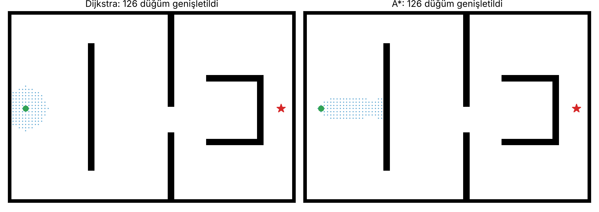
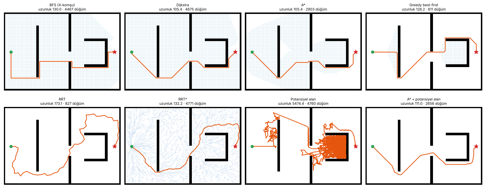

# Mobil Robotlar için Yol Planlama Algoritmaları

Izgara haritası üzerinde klasik yol planlama algoritmalarının sıfırdan yazılıp aynı senaryolarda karşılaştırılması: graf arama (BFS, Dijkstra, A*, ağırlıklı A*, greedy best-first), örnekleme tabanlı planlama (RRT, RRT*) ve yapay potansiyel alan. Otonom Sistemler dersi kapsamında konuları pekiştirmek için hazırladım.

> **English:** Grid-based path planning from scratch: BFS, Dijkstra, A*, weighted A*, greedy best-first, RRT, RRT* and artificial potential fields. The planners are compared on the same maps; the U-shaped trap shows why potential fields alone get stuck in local minima and how a global planner fixes that.



## U-tuzaklı labirentte karşılaştırma



| Yöntem | Yol uzunluğu | Kısaltılmış yol | Genişletilen düğüm / örnek |
|---|---|---|---|
| BFS (4-komşu) | 130,0 | 100,9 | 4.467 |
| Dijkstra | **105,4** | 101,0 | 4.675 |
| A* | **105,4** | 100,6 | 2.903 |
| Ağırlıklı A* (w=2) | 111,0 | 107,4 | 992 |
| Greedy best-first | 126,2 | 108,2 | 611 |
| RRT | 173,1 | 130,2 | 827 |
| RRT* (6.000 örnek) | 132,2 | 118,3 | 4.771 |
| Potansiyel alan | 5.474 (45 kez takıldı) | – | 4.760 |
| A* + potansiyel alan | 111,0 | – | 2.656 |

"Kısaltılmış yol", bulunan yoldaki gereksiz ara noktaların görüş hattı (line-of-sight) kontrolüyle atılmasından sonraki uzunluktur. Rastgele haritadaki sonuçlar için: `assets/results_random.md`.

## Çıkarımlar

- **A* ile Dijkstra aynı optimal yolu bulur**, ama A* hedefe doğru yönlendirildiği için %38 daha az düğüm genişletir. Octile sezgiseli 8-komşulu ızgarada kabul edilebilir ve tutarlıdır. Rastgele haritalarda fark 7 kata çıkıyor (468'e karşı 3.275 düğüm).
- **Ağırlıklı A*** (`f = g + w·h`) optimalliği bir miktar feda edip (%5 daha uzun) aramayı 3 kat hızlandırır. Bulduğu yolun maliyeti en fazla `w` katı olabilir.
- **Greedy best-first** yalnızca sezgisele baktığı için çok hızlıdır ama duvarların arkasına sapar ve optimal değildir.
- **RRT** hızlı bir çözüm bulur ama yol zikzaklıdır. **RRT*** yeniden bağlama (rewire) ile yolu kısaltır ve örnek sayısı arttıkça optimale yakınsar.
- **Potansiyel alan** tek başına U şeklindeki engelde takılır: çekme ve itme kuvvetleri dengelenir (yerel minimum). Rastgele yürüyüşle kaçış denense bile yol çok uzar. Pratikteki çözüm, **global bir planlayıcının (A*) ara hedeflerini potansiyel alanla takip etmektir.** A* yerel minimumu çözer, potansiyel alan engellerden mesafeyi korur.

## Kod

| Dosya | İçerik |
|---|---|
| `planning/grid.py` | Doluluk ızgarası, 8-komşuluk (köşe kesme yok), çarpışma kontrolü, engel şişirme |
| `planning/search.py` | BFS, Dijkstra, greedy, A* / ağırlıklı A* (tek öncelik kuyruğu iskeleti), yol kısaltma |
| `planning/rrt.py` | RRT ve RRT* (en ucuz ebeveyn seçimi + yeniden bağlama) |
| `planning/potential_field.py` | Çekici/itici potansiyel (mesafe dönüşümü ile), takılma algılama, A* rehberli sürüm |
| `compare.py` | Tüm yöntemleri çalıştırır, tablo ve görseller üretir |
| `tests/` | A* = Dijkstra maliyeti, ağırlıklı A* sınırı, çarpışmasız yol, RRT* > RRT, U-tuzağı testleri |

## Çalıştırma

```bash
pip install -r requirements.txt
python compare.py                       # labirent
python compare.py --map random --seed 4
python compare.py --gif                 # A* / Dijkstra animasyonu
python -m pytest -q
```

## Lisans

MIT. Bkz. [LICENSE](LICENSE).
